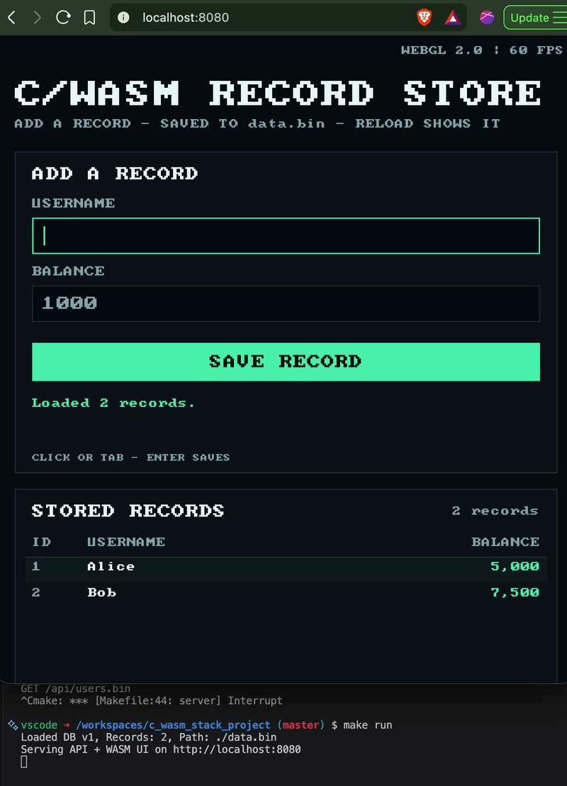

# Bare Metal C WASM Architecture Stack



A zero dependency, ultra lightweight ecosystem featuring an asynchronous Linux socket server, a versioned flat binary database, and a hardware accelerated WebGL 2.0 user interface written entirely in C and compiled to WebAssembly.

## Architecture Stack
* Backend: Native Linux epoll API for asynchronous, single threaded, event driven I/O.
* Database: Flat, custom versioned binary serialization format mapping directly to memory structs.
* Frontend: All UI, input handling, HTTP requests, and WebGL rendering live in `ui.c` and run as WebAssembly. `index.html` is only the loader for the generated WASM bundle; there is no application JavaScript.
* Testing Engines: Dual benchmarks capturing raw network Transactions/Sec (TPS) and browser GPU frame latency (ms).

## Project Layout
```text
db.h               Binary record/header schema
server.c           epoll HTTP server, static assets, flat-file database
ui.c               Full WASM UI: form, record list, input, fetch, WebGL 2.0
font8x8.h          Public-domain 8x8 bitmap font used by the UI renderer
index.html         Minimal canvas host for the generated ui.js/ui.wasm
benchmark_api.c    Multithreaded load generator
Makefile           All setup, build, run, benchmark, and clean tasks
.devcontainer/     Debian development container definition
```

## 1. Install Dependencies (Debian)
On a clean Debian host:
```bash
make setup
```
This installs `build-essential`, `emscripten`, `nodejs`, `python3`, `curl`, and
CA certificates, then prints the resulting toolchain versions. `make setup`
uses `sudo` only when it is not already running as root. The devcontainer runs
it automatically through `postCreateCommand` in `.devcontainer/devcontainer.json`.

## 2. Build
```bash
make build
```
This compiles the static backend, the load generator, and the C/WASM UI. Run
`make help` to list every target.

### Frontend implementation notes
* `ui.c` contains the complete interface: bitmap-font text rendering, layout,
  hit testing, keyboard handling, `emscripten_fetch` calls, and the WebGL 2.0
  draw loop.
* `index.html` is a 608-byte loader with a canvas and the generated
  `<script src="ui.js">`. There is no application JavaScript.
* Records are fetched as a raw `UserRecord[]` array from `/api/users.bin`, so
  the C frontend does no JSON parsing.
* The 8x8 font in `font8x8.h` is public domain and is rasterized directly into
  colored quads, avoiding texture uploads.
* The backend serves `index.html`, `ui.js`, and `ui.wasm` itself, so the whole
  application runs on one origin and one port.

## 3. Run
```bash
make run
```
Open http://localhost:8080. The C server serves the API and the compiled
frontend from a single port. There is no separate frontend server and no port
8000; `make run` serves both from `server.c`. Startup prints:

```text
Loaded DB v1, Records: 2, Path: ./data.bin
Serving API + WASM UI on http://localhost:8080
```

Each request is also logged (except the benchmark endpoint). If startup reports
`bind: Address already in use`, stop the other server instance first.

The UI is entirely native C running in WebAssembly:

* Click the `USERNAME` field and type a name.
* Click `BALANCE` or press `Tab` to enter an unsigned 32-bit amount.
* Press `Enter` or click `SAVE RECORD`.
* The record is appended to `data.bin`, the page re-fetches the record array,
  and the table updates without a page reload.
* Pressing reload starts a fresh WASM instance, which reads the same records
  back from disk.

The list supports mouse-wheel scrolling when there are more records than fit.
The top-right HUD reports live WebGL frame rate.

The backend stores records in `data.bin` next to the binary. Override the path:
```bash
make run DB_PATH=/tmp/cwasm-data.bin
```
Because every write flushes the database, keep `data.bin` on local storage when
measuring throughput. On this devcontainer the workspace is mounted through
virtiofs, so use `/tmp` for benchmarks.

## 4. HTTP API
The C server exposes the API and the frontend on the same origin:

| Method | Path | Purpose |
| --- | --- | --- |
| `GET` | `/api/users` | JSON list of records |
| `GET` | `/api/users.bin` | Raw `UserRecord[]` array used by the WASM UI |
| `POST` | `/api/users` | Add a record (`username`, `balance` form fields) |
| `GET` | `/api/bench` | Load-test endpoint (increments the two seed accounts) |
| `GET` | `/health` | Plain-text health check |
| `GET` | `/` | `index.html` |
| `GET` | `/ui.js`, `/ui.wasm` | Generated Emscripten frontend bundle |

Examples:
```bash
curl http://localhost:8080/api/users
curl -X POST -d 'username=Carol&balance=1234' http://localhost:8080/api/users
```

## 5. Run the Stress Test
With the server running:
```bash
make benchmark
```
Override the load without editing the Makefile:
```bash
make benchmark BENCH_THREADS=16 BENCH_REQUESTS=10000
```
| Variable | Default | Meaning |
| --- | --- | --- |
| `BENCH_THREADS` | `8` | Concurrent client threads |
| `BENCH_REQUESTS` | `5000` | Requests per thread |
| `BENCH_PORT` | `8080` | Backend port |
| `BENCH_IP` | `127.0.0.1` | Backend address |

## 6. Clean
```bash
make clean      # remove binaries and WASM artifacts
make distclean  # also remove data.bin
```

## Benchmark Results

Measured locally over the loopback interface on 2026-10-19:

| Threads | Requests | Failed | Duration | Throughput |
| ---: | ---: | ---: | ---: | ---: |
| 8 | 40,000 | 0 | 0.6302 s | **63,475.79 TPS** |
| 16 | 32,000 | 0 | 0.4884 s | **65,521.98 TPS** |

Test environment: Debian 13 (trixie) devcontainer, 8 vCPU, 5.8 GiB RAM,
`gcc -O3 -static` build, one TCP connection per request, one database flush per
request. Measure with the browser closed: the headless WebGL UI competes for
CPU. Run-to-run variance of roughly 15-20% was observed with host load; the
8-thread figure is typically in the 45,000-65,000 TPS range.

The database was placed on the local overlay filesystem (`/tmp`). The
workspace is mounted through virtiofs, where per-request flushes drop the same
workload to roughly 10,000 TPS. Reproduce with:
```bash
make run DB_PATH=/tmp/cwasm-data.bin
make benchmark BENCH_THREADS=8 BENCH_REQUESTS=5000
```

The frontend GPU benchmark is reported by the in-browser HUD and console once
http://localhost:8080 is opened. Headless software rendering (SwiftShader)
reported 28-59 FPS, which is not representative of real GPU performance.

## Verification

Checks performed in this devcontainer on 2026-10-19:

* `make clean && make build` produced `socket_server`, `benchmark_api`,
  `ui.js` (~46 KB), and `ui.wasm` (~33 KB).
* `POST /api/users` returned `201` and appended a record.
* `/api/users.bin` returned 96 bytes for the two seed records and 144 bytes
  after adding one, confirming the shared 48-byte `UserRecord` layout. Static
  assertions in `db.h` keep `DBHeader` at 16 bytes and `UserRecord` at 48 bytes.
* Restarting the server preserved appended records; a record added through the
  WASM UI was still present after a page reload.
* The UI was exercised in headless Chromium with WebGL 2.0/SwiftShader:
  synthetic keyboard input added `Zoe` with balance `4242`, the HUD showed
  `Saved Zoe. 6 records loaded.`, and a reload listed all six records.
* `make benchmark` with the browser closed: 40,000 requests at 8 threads
  (0 failed, 63,475.79 TPS) and 32,000 requests at 16 threads (0 failed,
  65,521.98 TPS).
* The software-rendered headless UI reported 28-59 FPS; a real GPU will differ.

## Storage Footprint
Data updates are flushed to a local binary stream file (`data.bin`) on every
write. The header (`magic`, schema `version`, `record_count`) maps fixed-size
`UserRecord` structs directly onto disk without per-row allocations and guards
against schema mismatches. Invalid or truncated files are recreated from the
two seed accounts (Alice/Bob) instead of crashing the server.

The WASM UI consumes the same `UserRecord` layout through `/api/users.bin`, so
no JSON parsing is required in C.

## Operational Notes
* Requests are read in edge-triggered epoll mode and buffered until the HTTP
  header terminator and declared body have arrived, so split packets work.
* `SIGPIPE` is ignored and writes use `MSG_NOSIGNAL`; clients that disconnect
  early cannot take the server down.
* Bind/listen failures are fatal, so a port clash is reported instead of
  silently listening on a random ephemeral port.
* The UI uses `emscripten_fetch` from C. The only JavaScript on the page is the
  loader emitted by Emscripten for the WASM module.
